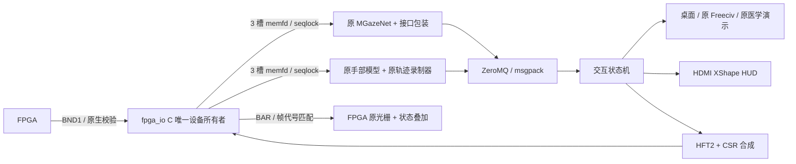

# HMI v2 本地整合架构

本次以附件方案为技术规格；原始 ZIP、解出的 baseline 和原模型全部保留。用户明确选择“先完成本地整合与验证”，没有连接开发板，没有安装服务、改驱动或烧写 Flash。

八个 systemd 服务：fpga-io、gaze、hand、engine、ui、hud、adapters、console。fpga-io 的 Python 侧只做消息编解码和读取共享头；只有它启动的 C 进程打开设备。视觉和 UI 没有 BAR、V4L2、DMA 访问权限入口。

每个观测主题一个 PUB 端点，整条 msgpack 为单帧消息，CONFLATE 保留最新值。事件队列上限 64，不重播。多个 sys.metrics 发布者各有独立端点，防止多个 bind 冲突。设计参考 libzmq 官方 ZMQ_CONFLATE 单消息限制：https://libzmq.readthedocs.io/en/latest/zmq_setsockopt.html 。

硬件共享内存保留 RGB640×360、128² 和 192² 三平面原字节；读者用原生 acquire fence、seqlock 二次检查及 CRC 后复制成不可变 bytes，再调用原 detector_frame.make_frame。旧 GZMDL002 导出仍保留。

动作由统一状态机产生：源时间 ≤350ms、至少 3 个新帧、保持/释放门限、冲突手势作废；确认额外要求眼动源时间 ≤250ms。动作有唯一 id，适配器消费后不重发。任何必需服务失联 2s 进入 DEGRADED。硬件 epoch、眼动服务实例或标定者 track 改变会使旧标定失效。

算法和模型在 vendor 中按来源复制并冻结；PROVENANCE 仅用于离线校验。保留原模型加载器自身的 hash 校验。动态限速放在帧读取边界；不会把跳过推理的正常帧伪装成无效帧反复重置滤波器。
