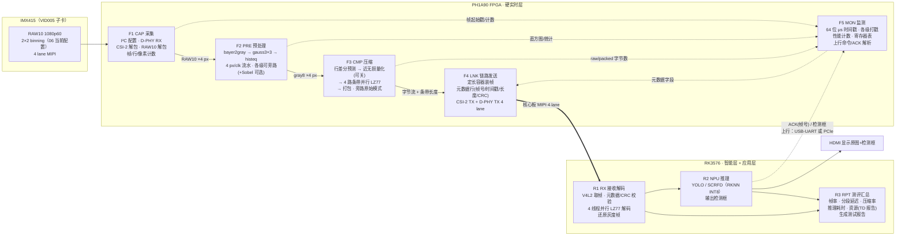
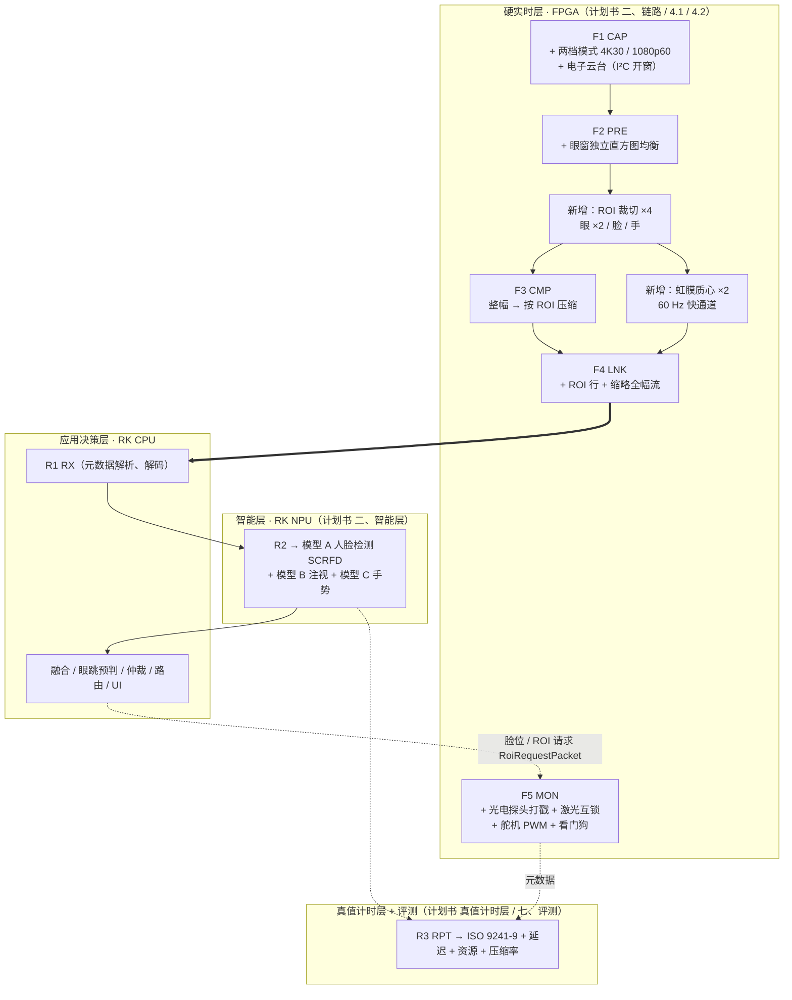

# 赛题三 · 六项基础功能的模块规划（第一步：六功能小系统）

> 依据：`e:\zhuge\安路.pdf` 选题三「2. 硬性交付基础任务」与「四、量化评分指标」；
> `project_fixed_20260922/plan_v3_无接触人机交互系统.docx`；`nchci/port/fpga_spec.md`；
> 已上板成功的 06 例程与厂商异构例程 `03_course/07_异构方案/415_mipi`、`AFC03_IMX415_PCIE_X1`。
> 本文只做规划，不含任何编译/上板结论。文中资源和时延数字都是估算，以后用 TD 报告和实测值替换。

---

## 0. 结论先行

1. **六项基础功能用 8 个模块实现：FPGA 5 个，RK3576 3 个。** 不能一项功能对应一个模块，原因有两条：第 4 项“高速交互通道”横跨两颗芯片，两端各需要一个模块；第 6 项“测试报告”的数据来源必须在 FPGA 内部打时间戳和计数（这样才是物理真值），汇总则在 RK 上完成。
2. **FPGA 承担第 1–4 项的全部实现，以及第 6 项的计时和计数。** 第 5 项（NPU 推理）由 RK 完成，但 FPGA 可以把 NPU 输入的预处理（缩放、letterbox、INT8 排布）做成硬件，对应赛题标题里的“AI 特征加速”。
3. **第一步小系统不需要 DDR，全部按行流水完成**：采集 → 预处理 → 压缩 → 装帧发送，整条链路无整帧缓存。DDR 留给后续的帧差和 7 寸屏本地预览。
4. 小系统的每个模块都按计划书 v3 的接口来设计（像素总线、元数据行、寄存器表），后续接入 ROI、虹膜质心、电子云台时不用推倒重来。

---

## 1. 六项硬性任务 → 8 个模块

| # | 赛题硬性任务 | 承担模块 | 所在芯片 | 复用基线 |
|---|---|---|---|---|
| 1 | MIPI CSI 驱动 IP，单路高清实时采集 | **F1 CAP 采集** | FPGA | 06 例程：`ui_cfg_imx415` + `mipi_dphy_rx_over_lvds_wrapper` + `ui_csi_unpacket_4lane` + `ui_raw10_unpacket_4lane` |
| 2 | 3 种基础预处理，硬件并行 | **F2 PRE 预处理** | FPGA | 新写；数值以 `nchci/port/golden_vectors.py` 为准 |
| 3 | JPEG/LZ77 硬件压缩，输出低带宽流 | **F3 CMP 压缩** | FPGA | 新写；码流以 `golden_vectors.lz77_compress` 为准 |
| 4 | FPGA↔RK 高速通道，稳定传输压缩帧 | **F4 LNK 链路发送** + **R1 RX 接收解码** | FPGA + RK | 厂商 `415_mipi`：`csi2_frame_tx` + `mipi_dphy_tx_wrapper`；RK 端 `milianke_mipi.c` 驱动 + DTS |
| 5 | NPU 轻量目标检测本地推理 | **R2 NPU 推理** | RK | 厂商 `yolo识别+自启动/rk3576_yolov5s_*.py`，RKNN INT8 |
| 6 | 测试报告：帧率、延迟、资源、压缩率、推理耗时 | **F5 MON 监测**（计时/计数/寄存器）+ **R3 RPT 测评汇总** | FPGA + RK | 01 例程 UART；TD 资源报告；`rknn` 性能计数 |

---

## 2. 模块架构图（第一步小系统）



### 2.1 各模块边界（小系统版本）

| 模块 | 输入 | 输出 | 关键规格 | 主要风险 |
|---|---|---|---|---|
| F1 CAP | IMX415 MIPI | `raw10[39:0]` 4 px/clk、`sof`/`eol`、`hs_rx_clk` | 保留 06 的 1080p60 binning 配置；加入帧/行/像素计数和 lane 错误计数 | `hs_rx_clk` 实际频率要用频率计实测，不从参数推算 |
| F2 PRE | 4 px/clk RAW10 | 4 px/clk gray8 | 灰度 1 行缓冲、高斯 2 行缓冲、直方图 4 路统计 + 帧末生成 LUT + 乒乓查表；三级同时工作；每级可旁路，旁路时仍保持相同延迟 | `fpga_spec.md` 按 2 px/clk 写，需要改成 4 px/clk；golden 需补一个 4 px 打包的激励导出 |
| F3 CMP | 4 px/clk gray8 | 字节流 + 每条带 `packed_len` | 每行切成 4 个 480 px 条带，每个条带一个 LZ77 引擎（各自独立字典）；无损 / 近无损（NEAR=k）两种模式；帧级码率控制；旁路原始模式 | 最坏情况吞吐必须有保证，见 §4.1；码流格式与 `hal/lz77.py` 不一致的问题在迁移前统一 |
| F4 LNK | 字节流 + 元数据 | CSI-2 帧 | 定长容器：元数据行 + 负载行，长度不足补 0；DT、宽、高三项参数化 | RK 端 rkcif 是否原样透传字节，需要先用计数图案做逐字节比对 |
| F5 MON | 各级脉冲/计数 | 元数据字段、寄存器读回 | 各级打戳：帧起始、预处理出第一行、压缩完成、TX 发出 FE、收到 RK ACK；延迟全部在 FPGA 同一时钟里相减 | 上行物理通路尚未确定，见 §5 风险 2 |
| R1 RX | `/dev/videoN` | 灰度帧 + 元数据 | 设备号动态发现；C 语言解码，4 个条带交给 4 个线程并行 | Python 解码跟不上 60 fps |
| R2 NPU | 灰度帧（复制成 3 通道） | 检测框 | 起步用厂商 YOLOv5s；接入计划书后换成 SCRFD 人脸检测 | 单通道灰度对 YOLO 精度的影响要实测 |
| R3 RPT | FPGA 元数据 + RK 计时 + TD 报告 | `report.md` / `csv` | 硬性任务第 6 项的五类数据全部自动生成 | — |

### 2.2 帧格式（F4 → R1，小系统）

第一步直接复用厂商驱动已支持的 **YUV422 1920×1080@60**，把它当作一个字节容器（每行 3840 字节，共 1080 行），不改驱动和 DTS：

```
第 0 行      : 元数据行，256 B 有效（沿用 protocol.MetadataRow 字段：magic/帧号/ts_us/模式/
               raw_bytes/packed_bytes/4 个条带长度/各级时间戳/CRC16），其余字节补 0
第 1..N 行   : 4 个条带的压缩码流顺序拼接，按 3840 B 切行
第 N+1..1079 : 补 0（容器剩余部分）
```

- **第一步**：容器大小固定，线上带宽不变。压缩率根据元数据里的 `packed_bytes / raw_bytes` 统计。这一步只验证链路逐字节正确和解码无损。
- **第二步**：修改 RK 驱动或 DTS 的分辨率，把容器缩到 1920×360（约为原始灰度帧的 1/3）。这时线上实际带宽下降，满足“输出压缩后低带宽数据流”的字面要求。无损模式下如果某一帧放不下，就置溢出标志并计数；近无损模式由码率控制保证一定能放下。
- **第三步（可选）**：实测 rkcif 是否接受每帧行数可变。如果接受，改成变长帧。

---

## 3. 接入计划书 v3：模块放在哪里

### 3.1 小系统 → 完整系统的四层映射



### 3.2 逐模块对应到计划书章节

| 模块 | 计划书 v3 中的位置 | 小系统做到什么程度 | 接入完整系统时要补的内容 |
|---|---|---|---|
| F1 CAP | 一、系统总体（主摄段落）；二、硬实时层第一项；4.1 相机与光学布局；`fpga_spec` §3.1、§7 | 06 的 binning 1080p60，即计划书的“思路 C” | 4K30 全幅模式和裁切 1080p60 模式；§7.2 规定的 REGHOLD 开窗验证（计划书唯一需要提前验证的一项） |
| F2 PRE | 二、硬实时层“三种硬件预处理”；4.2“三种预处理”；`fpga_spec` §3.2–3.4 | 整幅三级流水 | 眼窗独立的直方图均衡；为虹膜阈值复用直方图 |
| F3 CMP | 二、硬实时层“行差分 + LZ77”；4.2“压缩”；`fpga_spec` §3.7 | 整幅 4 条带并行 | 改成按 ROI 槽位压缩；多人模式下引擎数增加 |
| F4 LNK | 二、硬实时层“经核心板 MIPI 4LANE 互联送 RK”；`fpga_spec` §3.8–3.9 | 定长容器 + 元数据行 | ROI 行 + 眼窗结果提前发出（§4.2 亮点 1） |
| F5 MON | 二、硬实时层“时间戳、光电探头、激光互锁”；真值计时层；`fpga_spec` §3.10–3.13、§4 寄存器表 | 时间戳、计数、ACK 延迟 | 光电探头、激光与舵机 PWM、看门狗、电子云台控制 |
| R1 RX | 六、数据链路表“CSI 接收 + DMA”；`RK3576_PORTING.md` | V4L2 + 解码 | `MipiFpgaSource.read_with_meta()` 与 PC 端 `fpga_sim` 统一 |
| R2 NPU | 二、智能层“模型 A” | YOLOv5s 目标检测 | 换成 SCRFD；**输入源改为 FPGA 发来的流**（见 §3.3 第 1 条） |
| R3 RPT | 七、评测方案（“压缩与带宽”“FPGA 资源、NPU 耗时”两行）+ 末尾“与赛题硬性任务的对应”段落 | 自动生成第 6 项报告 | 并入 ISO 9241-9 与光电延迟 |

### 3.3 建议修改计划书的地方

1. **第 5 项的检测输入要来自 FPGA 链路。** 计划书目前让模型 A（人脸检测）跑在副摄上，副摄由 RK 直采。这样第 4 项传过去的压缩帧和第 5 项的推理在数据上没有关系，评委可能认为“压缩传输”只是摆设。建议 FPGA 除 ROI 之外，再发一路缩略全幅流（例如 960×540 灰度，压缩后传输），人脸/人体检测跑在这路流上。检测结果再回传给 FPGA 驱动电子云台，形成“FPGA 采集 → 压缩 → NPU 检测 → 回传 → FPGA 开窗”的闭环。副摄保留给手势和多人上下文。
2. **上行通路要重写。** 核心板上 RK 与 FPGA 之间只有 MIPI 4 lane 和 PCIe x1，计划书里写的“底板 UART 回传”不存在直连通路。见 §5 风险 2。
3. **7 寸屏由谁驱动要选定。** 计划书写的是 RK 的 DSI；已上板的 05/06 例程是 FPGA 经 VID005 驱动 7 寸屏。两种都可以，但不能同时接。建议小系统阶段用 FPGA 驱动（调试时直接看预处理结果），完整系统再切回 RK。
4. **4.2 节可以补一条“NPU 输入预处理下沉 FPGA”**，同时把 06 当前是 binning 配置这一事实写进 4.1 的可行性段落。

---

## 4. FPGA 应该承担的全部功能，以及创新亮点

### 4.1 必须承担的功能

| 类别 | 功能 | 来源 |
|---|---|---|
| 赛题硬性任务 | 第 1–4 项全部；第 6 项的时间戳、计数、带宽和压缩率统计 | 选题三 |
| 计划书既定功能 | 两档采集、电子云台、ROI 裁切 ×4、眼窗均衡、虹膜质心 ×2、元数据行、光电探头打戳、激光 PWM 与三重互锁、舵机 PWM、上行解析与看门狗 | 计划书 二、4.2、4.11；`fpga_spec` |
| 保证吞吐 | LZ77 在最坏情况下也要有吞吐保证：每个引擎每拍处理 1 字节。窗口按“地址 mod 32”分成 32 个 bank，一拍读出 18 字节候选，与前瞻缓冲比较后用前导一编码得到匹配长度。这样吞吐与图像内容无关 | 对 `fpga_spec` §3.7 的改进：原方案平均约 1.5 拍/字节，最坏 6 拍/字节，吞吐随内容变化 |

### 4.2 创新亮点：“低智能、高实时”

原则：NPU 负责需要“智能”的部分，频率低、延迟高；FPGA 负责确定性的经典算法，逐帧甚至逐行工作，延迟在微秒级，并且不依赖 NPU 的结果也能独立运行。

| # | 亮点 | 实时性体现 | 对应评分项 | 资源特点 |
|---|---|---|---|---|
| 1 | **眼窗结果按行提前发出**：眼窗最后一行读出后约 50 μs，就把质心结果作为一行短元数据发给 RK，不等整帧读完 | 眼窗通常位于画面上半部分，比帧结束早数毫秒 | 延迟可视化、实时性 | 很少 |
| 2 | **FPGA 眼跳起始检测**：对 60 Hz 质心序列做速度阈值判断，再查主序列 LUT 得到幅度下界，结果写入元数据，带微秒时间戳 | 计划书 4.5“起始即预测”的检测环节下沉到硬件，CPU 直接拿到起始事件 | 自主创意 | 少量 DSP |
| 3 | **硬件自动曝光和增益闭环**：用 F2 的直方图逐帧调节 IMX415 的曝光和增益（I²C），眼窗优先 | 每帧调节一次，不经过 RK | 评分“光线剧烈变化时工作正常”；高阶“自动曝光” | 少量 |
| 4 | **NPU 输入预处理下沉**：FPGA 直接输出 640×384 letterbox 的 INT8 排布图，RK 零拷贝送入 rknn | RK 省去缩放和格式转换的 CPU 耗时 | 赛题标题中的“AI 特征加速” | 多相缩放用 DSP 和行缓冲 |
| 5 | **多引擎 LZ77 + 无损/近无损双模式 + 帧级码率控制** | 吞吐有保证；带宽可预知 | 高级：“无损+有损双模式”“自适应码率” | 大量 BRAM（每引擎 4 KB 窗口 + 哈希表），4K30 用 8 引擎 |
| 6 | **硬件 ROI 跟踪**：NPU 每 N 帧给一次脸/眼位置，中间帧由 FPGA 在搜索窗内做 SAD 模板匹配，逐帧更新 ROI 和电子云台位置 | 电子云台跟随从 NPU 的 30 Hz 提升到 60 Hz，并且不受 NPU 抖动影响 | 高阶“动态目标跟踪与坐标叠加” | **主要资源消耗项**：SAD 阵列占用大量 LUT 和 DSP |
| 7 | **帧差运动检测**：用 DDR 存上一帧，输出运动掩码和运动框 | 支撑“旁人走过”的鲁棒性判断；无人时降低 NPU 频率 | 高阶“硬件运动目标检测” | DDR 控制器 + 带宽 |
| 8 | **全链路打戳与延迟瀑布图**：每一级在 FPGA 同一时钟里打戳，RK 回 ACK 也在 FPGA 时钟里计时，加上光电探头给出显示真值 | 延迟分解不依赖两颗芯片之间的时钟同步 | 第 6 项；高阶“处理延迟可视化” | 很少 |

### 4.3 资源目标（估算，以 TD 报告为准）

PH1A90：LUT4 115,776 / FF 128,640 / ERAM20K 272（5,440 kb）/ DSP 240 / PLL 12。

| 阶段 | LUT | ERAM | DSP | 说明 |
|---|---|---|---|---|
| 小系统 F1–F5（含 MIPI RX/TX IP） | 约 12–18 k | 约 40–60 | < 10 | 4 引擎 LZ77 是 ERAM 的主要来源 |
| + 计划书既定功能 | +6–8 k | +15 | +8 | 按 `fpga_spec` §6 估算，并换算成 4 px/clk |
| + 亮点 1–5、8 | +10–15 k | +60–90 | +30–50 | 8 引擎 LZ77、缩放 |
| + 亮点 6、7 | +25–40 k | +20–40 | +60–120 | SAD 跟踪器、DDR 帧差 |
| **目标总占用** | **约 60–80 %** | **≤ 80 %** | **约 50–80 %** | 不建议超过 85 %，否则时序收敛和布线会很困难 |

“把资源用尽”的建议做法：把 ERAM 和 DSP 用满（多引擎压缩、跟踪、缩放都能按引擎数或并行度线性扩展），LUT 留 15–20% 余量用于时序收敛。这样资源占用可以按需要调整，只改参数即可。

---

## 5. 风险与待验证项（按优先级）

| # | 风险 | 验证方法 | 不通过时的退路 |
|---|---|---|---|
| 1 | 厂商 `415_mipi` 的 FPGA→RK 链路在本板上能否复现；rkcif 是否原样透传 YUV 字节 | 先原样编译厂商工程上板；然后 F4 发计数图案，RK 端逐字节比对 | 改走 PCIe 例程（`AFC03_IMX415_PCIE_X1`，`/dev/video73`） |
| 2 | 上行通路（RK→FPGA）：核心板上没有 UART 直连 | 方案 a：RK 的 USB Host 连底板 FPGA 的 Type-C UART，桥芯片在 Linux 上通常免驱；方案 b：RK 底板 UART 端子用杜邦线接 FPGA 空闲 3.3 V IO；方案 c：PCIe BAR0 mailbox（计划书长期方案） | 小系统阶段先用方案 a；ACK 延迟统计也可以暂时只用 RK 本地时钟 |
| 3 | `hs_rx_clk` 频率和每拍像素数与 `fpga_spec` 假设不同 | F5 频率计实测；读 06 的 IPC 和生成代码 | 在 F1 和 F2 之间加一个异步 FIFO，切换到自有像素时钟 |
| 4 | 灰度 + 高斯平滑后，无损 LZ77 的压缩率能否达到 ≥ 30% 的指标 | 在 PC 上用 `golden_vectors` 对实拍 dump 跑统计 | 启用近无损模式（NEAR=1–2） |
| 5 | RK 端 LZ77 解码速度能否跟上 60 fps | C 实现，4 线程基准测试 | 降到 30 fps 或降低容器分辨率 |
| 6 | 7 寸屏的 D-PHY TX 与 RK 链路的 D-PHY TX 能否在同一工程里共存 | 读两个例程的引脚和 IP，TD 编译验证 | 小系统阶段只保留 RK 链路 |

---

## 6. 第一步实施顺序（先打通链路，再往里加处理）

工程放在新目录 `fpga-lab/projects/t3_basic6/`，由 06 例程和 `415_mipi` 合并克隆而来，不修改 `examples/` 里的原例程。

| 步 | 内容 | 验收标准（每步分别报告：仿真 / 编译时序 / 上板） |
|---|---|---|
| S0 | 原样复现厂商 `415_mipi`：相机 → FPGA → MIPI → RK | RK 用 `gst-launch` 看到实时画面；记录设备号、分辨率、帧率 |
| S1 | 合并工程，F1 保留 06 采集，加入 F5 的计数、频率计和寄存器读回 | FPGA 内部测得帧率 60 ± 0.1，每帧 1080 行、每行 1920 px，lane 错误为 0 |
| S2 | F4 容器装帧，先发计数图案，再发原始灰度 | RK 端逐字节一致，连续 10 分钟无错；元数据 CRC 全部通过 |
| S3 | F2 三级预处理（4 px/clk）+ golden 对拍 | 仿真与 golden 逐位一致；上板后 RK 收到的灰度帧与同一帧 dump 喂给 golden 的结果一致 |
| S4 | F3 四条带 LZ77 + R1 C 解码 | 仿真码流与 golden 逐字节一致；上板解码结果与旁路模式逐位相同；统计压缩率 |
| S5 | R2 YOLO 推理，HDMI 显示原图和检测框 | 推理帧率、单帧耗时 |
| S6 | 上行 ACK + R3 报告生成 | 自动输出帧率、分段延迟、TD 资源、压缩率、推理耗时，覆盖硬性任务第 6 项的全部五类数据 |
| S7 | 容器缩小到 1920×360，启用近无损和码率控制 | 线上实际带宽下降到原来的 1/3 左右，60 fps 稳定运行 2 小时无错 |

S0 和 S2 是整个方案风险最高的两步，要最先做。S3、S4 的 RTL 可以在 S0–S2 进行期间先在仿真里并行开发。
